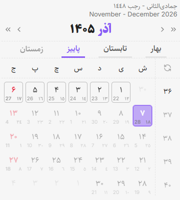
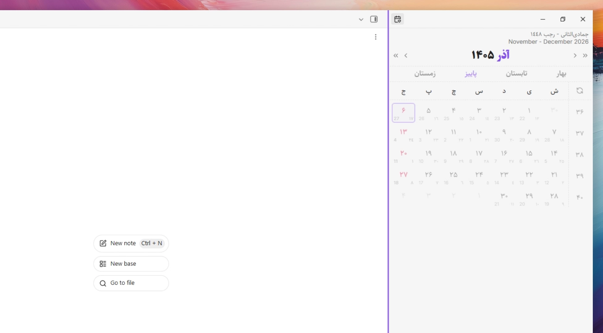
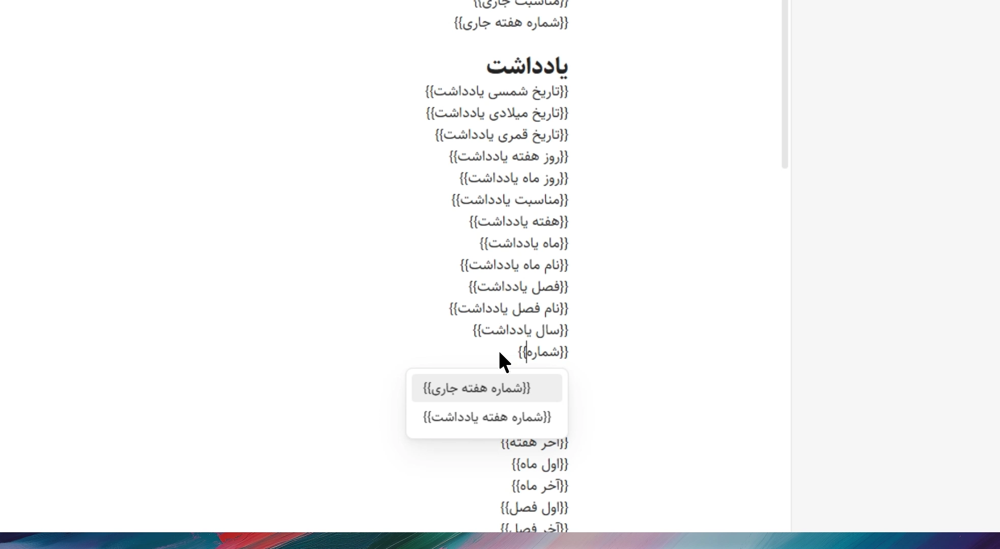
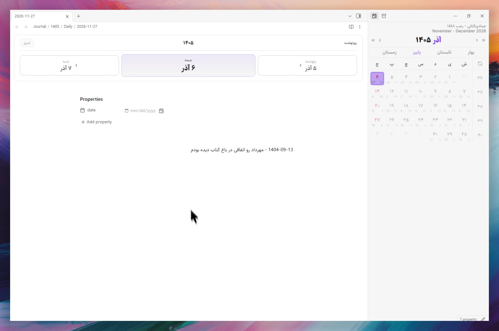
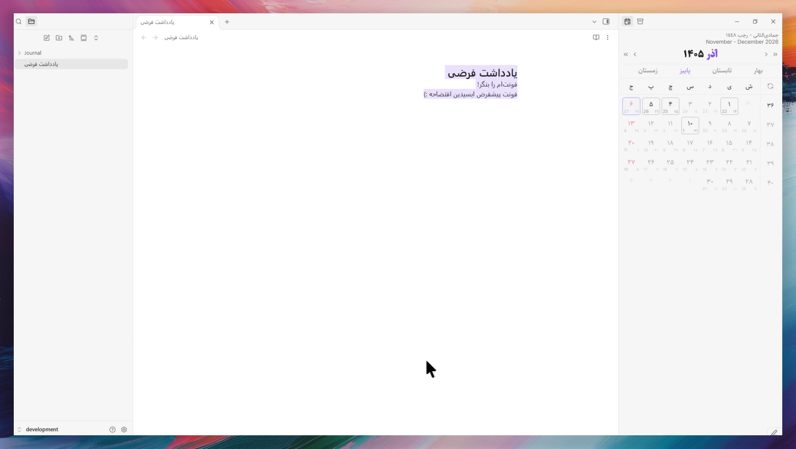

<p align="center" dir="ltr">
  <a href="README_FA.md">فارسی</a> · <strong><a href="README.md">English</a></strong>
</p>

# <a name="persian-calendar-plugin-for-obsidian"></a> Persian Calendar for Obsidian

Use the Jalali calendar in [Obsidian](https://obsidian.md/) to open periodic notes, view holidays, and work with dates. The interface is available in Persian and English.

[Installation](#installation-guide) · [Feature guide](#guid) · [Contributing](#collaboration)

<div align="center">



</div>

## Installation Guide

### <a name="first-method-recommended"></a> Community plugins

In **Settings → Community plugins → Browse**, search for **Persian Calendar**, then select **Install** and **Enable**.

[Obsidian plugin listing](https://community.obsidian.md/plugins/persian-calendar)

### <a name="second-method"></a> Manual installation

Download `main.js`, `manifest.json`, and `styles.css` from [GitHub Releases](https://github.com/karfekr/obsidian-persian-calendar/releases). Put them in `.obsidian/plugins/persian-calendar/` inside your vault, reload Obsidian, and enable **Persian Calendar** under **Community plugins**.

## <a name="guid"></a><a name="guide-to-the-essential-features"></a> Feature guide

[Calendar](#other) · [Paths and naming](#dynamic_path) · [Quick date links](#quick_reference) · [Automatic links](#auto_links)<br />
[Placeholders](#placeholders) · [Live expressions](#live_expressions) · [Custom events](#custom_events)<br />
[Date picker](#date-picker) · [Persian font](#persian-font) · [API](#api)

### <a name="other"></a><a name="other-features"></a> Calendar and navigation

The Persian calendar adjusts to the sidebar width.

<div align="center">



</div>

### <a name="dynamic_path"></a> Dynamic paths and naming

Set folders in **Calendar Note Paths** and the daily filename format in **Calendar Note Names**. The examples below use 1 Azar 1405 (22 November 2026).

| Setting | Pattern | Result |
| --- | --- | --- |
| Folder path · put date tokens in brackets | `Journal/[jYYYY]/Daily` | `Journal/1405/Daily` |
| Daily filename · use date tokens directly | `jYYYY-jMM-jDD` | `1405-09-01` |
| Daily filename · put literal text in brackets | `[Daily] YYYY-MM-DD` | `Daily 2026-11-22` |

Folder paths use square brackets around tokens; other text stays literal. Daily filenames use tokens directly and square brackets around literal text. Set paths for daily, weekly, monthly, seasonal, and yearly notes in **Calendar Note Paths**. The daily filename format is set in **Calendar Note Names**. Monthly and yearly note names can use Jalali or Gregorian years; week numbers follow the selected week calculation.

The same date tokens are available in folder paths for all five note types and in the daily filename format. Weekly folder paths also have the week number. Name tokens follow the selected interface language.

| Token | Meaning | Note types | Example for 1 Azar 1405 |
| --- | --- | --- | --- |
| `jYYYY`, `jYY` | Jalali year (4 or 2 digits) | All paths; daily filename | `1405`, `05` |
| `jMMMM`, `jMMM` | Jalali month name (full or abbreviated) | All paths; daily filename | آذر |
| `jMM`, `jM` | Jalali month number (padded or unpadded) | All paths; daily filename | `09`, `9` |
| `jDD`, `jD` | Jalali day number (padded or unpadded) | All paths; daily filename | `01`, `1` |
| `jQQQQ`, `jQQ`, `jQ` | Jalali season name or number (2 or 1 digit) | All paths; daily filename | پاییز, `03`, `3` |
| `YYYY`, `YY` | Gregorian year (4 or 2 digits) | All paths; daily filename | `2026`, `26` |
| `MMMM`, `MMM` | Gregorian month name (full or abbreviated) | All paths; daily filename | `November`, `Nov` |
| `MM`, `M` | Gregorian month number (padded or unpadded) | All paths; daily filename | `11` |
| `DD`, `D` | Gregorian day number (padded or unpadded) | All paths; daily filename | `22` |
| `DDDD` | Weekday name | All paths; daily filename | `Sunday` |
| `ww`, `w` | Configured week number (padded or unpadded) | Daily and weekly paths; daily filename | `36` |

### <a name="quick_reference"></a> Quick reference to calendar notes

Type `@` and pick a Persian date phrase such as `امروز` (today) or `این هفته` (this week) to insert a note link. Type `@/` to insert the resolved date or period as plain text. Suggestions cover days, weekdays, weeks, months, seasons, and years.

<div align="center">


</div>

### <a name="auto_links"></a> Automatic links between periodic notes

Add a list of note types to the parent note's `pc-auto-link` property. The plugin keeps `pc-links` up to date with matching notes already in your vault. For example, an Azar 1405 monthly note would have these properties if the two daily notes below were its only matches.

<div dir="ltr">

```yaml
---
pc-auto-link:
  - daily
  - weekly
pc-links:
  - "[[1405-09-01]]"
  - "[[1405-09-02]]"
---
```

</div>

| Parent note | Allowed entries in `pc-auto-link`        |
| ----------- | ---------------------------------------- |
| Weekly      | `daily`                                  |
| Monthly     | `daily`, `weekly`                        |
| Seasonal    | `daily`, `weekly`, `monthly`             |
| Yearly      | `daily`, `weekly`, `monthly`, `seasonal` |

A week that spans two Jalali months, seasons, or years can appear in both parent notes.

<div align="center">


</div>

### <a name="placeholders"></a> Placeholders

Type `{{` for suggestions. Add placeholders to a template under **Calendar Note Templates** to insert fixed values when the plugin creates a note. In an existing note, run **Replace Placeholders** from the command palette.

<div dir="ltr">

```text
{{تاریخ شمسی یادداشت}}
{{روز هفته یادداشت}}
{{مناسبت یادداشت}}
```

</div>

<div align="center">



</div>

<details>
<summary>Placeholder reference</summary>

Choose keys for the note's date or period, or use the current-date keys to capture today's values when you replace them. Elapsed and remaining days use the note's date when it can be resolved and today's date otherwise.

#### Daily Note Placeholders

`{{تاریخ شمسی یادداشت}}`, `{{تاریخ میلادی یادداشت}}`, `{{تاریخ قمری یادداشت}}`, `{{روز هفته یادداشت}}`, `{{روز ماه یادداشت}}`, `{{مناسبت یادداشت}}`

#### Weekly Placeholders

`{{هفته یادداشت}}`, `{{شماره هفته یادداشت}}`, `{{اول هفته}}`, `{{آخر هفته}}`

#### Monthly Placeholders

`{{ماه یادداشت}}`, `{{نام ماه یادداشت}}`, `{{اول ماه}}`, `{{آخر ماه}}`

#### Seasonal Placeholders

`{{فصل یادداشت}}`, `{{نام فصل یادداشت}}`, `{{اول فصل}}`, `{{آخر فصل}}`

#### Yearly Placeholders

`{{سال یادداشت}}`, `{{اول سال}}`, `{{آخر سال}}`

#### Current Time Placeholders

`{{تاریخ شمسی جاری}}`, `{{تاریخ میلادی جاری}}`, `{{تاریخ قمری جاری}}`, `{{روز هفته جاری}}`, `{{روز ماه جاری}}`, `{{هفته جاری}}`, `{{شماره هفته جاری}}`, `{{نام ماه جاری}}`, `{{ماه جاری}}`, `{{نام فصل جاری}}`, `{{فصل جاری}}`, `{{سال جاری}}`, `{{مناسبت جاری}}`

#### Elapsed and Remaining Days

`{{روزهای گذشته سال}}`, `{{روزهای باقیمانده سال}}`, `{{روزهای گذشته فصل}}`, `{{روزهای باقیمانده فصل}}`, `{{روزهای گذشته ماه}}`, `{{روزهای باقیمانده ماه}}`

</details>

### <a name="live_expressions"></a> Live expressions

Type `{+` and choose a key to display dates, Tehran time, or events that update in Reading View and Live Preview. In Live Preview, move the cursor outside the expression to see its value. Choose the output language and numerals independently in **Live Expressions** settings.

<div dir="ltr">

```markdown
**Date** · {+نام روز} {+روز ماه شمسی} {+نام ماه شمسی} {+سال شمسی}
**Gregorian** · {+سال میلادی}-{+شماره ماه میلادی}-{+روز ماه میلادی}
**Tehran time** · {+ساعت}:{+دقیقه}
**Year elapsed** · {+درصد سال شمسی}%
**Today's events** · {+مناسبت}
```

</div>

<div align="center">


</div>

#### Live countdowns

Use a Jalali date with digits `0–9` and an optional 24-hour Tehran time. Omit the time to target midnight. One-time countdowns show elapsed time after the target. Annual countdowns move on to the next occurrence.

| Example                  | One-time                 | Annual              |
| ------------------------ | ------------------------ | ------------------- |
| Nowruz                   | `{+1405-01-01}`          | `{+01-01}`          |
| Birthday lunch           | `{+1405-06-15 13:30}`    | `{+06-15 13:30}`    |
| Anniversary with seconds | `{+1405-09-10 18:45:30}` | `{+09-10 18:45:30}` |

<details>
<summary>Live expression keys</summary>

| Use                       | Keys inside <code dir="ltr">{+…}</code>                                                                         |
| ------------------------- | --------------------------------------------------------------------------------------------------------------- |
| Clock                     | `ساعت`, `دقیقه`, `ثانیه`                                                                                        |
| Jalali date               | `سال شمسی`, `نام ماه شمسی`, `شماره ماه شمسی`, `روز ماه شمسی`                                                    |
| Gregorian date            | `سال میلادی`, `نام ماه میلادی`, `شماره ماه میلادی`, `روز ماه میلادی`                                                |
| Lunar Hijri date          | `سال قمری`, `نام ماه قمری`, `شماره ماه قمری`, `روز ماه قمری`                                                    |
| Weekday and period        | `نام روز`, `شماره روز هفته`, `هفته سال`, `هفته ماه شمسی`, `فصل`, `شماره فصل`                                    |
| Day counts                | `تعداد روز سال شمسی`, `تعداد روز ماه شمسی`, `روز سال شمسی`, `روز فصل`                                           |
| Time remaining or elapsed | `روز باقی سال شمسی`, `روز باقی ماه شمسی`, `روز باقی فصل`, `روز باقی هفته`, `دقیقه مانده روز`, `دقیقه گذشته روز` |
| Percentage elapsed        | `درصد سال شمسی`, `درصد فصل`, `درصد ماه شمسی`, `درصد هفته`, `درصد روز`                                           |
| Events and holidays       | `مناسبت`, `تعداد مناسبت`, `تعطیل`                                                                               |

</details>

### <a name="custom_events"></a><a name="custom-event-repositories"></a> Custom events

The calendar can show official Iranian holidays and events, international observances, and your own events. In **Event Display**, enable **Show Custom Events**, then select **Add Custom Events**. Choose a vault note and the calendar its dates use (Jalali, Gregorian, or Lunar Hijri), then save.

Write one event per line in the note. The example below uses Jalali dates. Use `MM-DD` for annual events and `YYYY-MM-DD` for one-time events. Use digits `0–9` and hyphens in dates.

<div dir="ltr">

```text
06-15 | Birthday | purple
1405-09-10 | Office closed | | تعطیل
```

</div>

For the optional color in the third field, use `red`, `orange`, `yellow`, `green`, `cyan`, `blue`, `purple`, or `pink`. Put `تعطیل` in the fourth field to mark a holiday. Leave the third field empty to use the default color.

<div align="center">


</div>

### Date picker

Use the calendar icon beside an Obsidian `Date` property to choose a Jalali day. To insert or convert a date in the note body, run **Insert & Convert Date** from the command palette.

<div align="center">



</div>

### Persian font

The plugin bundles the [Sahel font](https://github.com/rastikerdar/sahel-font) as **Persian Calendar**. To use it in your notes, open **Settings → Appearance → Text font**, select **Manage**, and add **Persian Calendar**.

<div align="center">



</div>

### <a name="api"></a><a name="using-the-dedicated-api"></a> Plugin API

Use the API from another plugin or a script such as DataviewJS or Templater. See the [full method list](docs/architecture.md#public-plugin-api-apiservice) for calendar conversions, number formatting, and event queries.

<div dir="ltr">

```javascript
const pcApi = app.plugins.getPlugin("persian-calendar").api;

// Number conversion
pcApi.toEnNumber("۱۲۳ تست test"); // "123 تست test"
pcApi.toFaNumber("123 تست test"); // "۱۲۳ تست test"

// Jalali date conversion
pcApi.jalaliToDate(1405, 9, 13); // Equivalent Gregorian date as Date object
pcApi.jalaliToGregorian(1405, 9, 13); // {gy: 2026, gm: 12, gd: 4}
pcApi.jalaliToHijri(1405, 9, 13); // (Iran basis) {hy: 1448, hm: 6, hd: 24}
pcApi.jalaliToHijri(1405, 9, 13, { base: "umalqura" }); // (Umm al-Qura basis) {hy: 1448, hm: 6, hd: 24}
pcApi.jalaliMonthName(9); // آذر (Azar)
pcApi.jalaliMonthName(9, "en"); // Azar
pcApi.seasonName(3); // پاییز (Autumn)
pcApi.seasonName(3, "en"); // Autumn

// Gregorian date conversion
pcApi.dateToGregorian(new Date()); // {gy, gm, gd}
pcApi.gregorianToDate(2026, 12, 4); // Date object
pcApi.gregorianToJalali(2026, 12, 4); // {jy: 1405, jm: 9, jd: 13}
pcApi.gregorianToHijri(2026, 12, 4); // (Iran) {hy: 1448, hm: 6, hd: 24}
pcApi.gregorianToHijri(2026, 12, 4, { base: "umalqura" }); // (Umm al-Qura basis) {hy: 1448, hm: 6, hd: 24}

// Lunar Hijri date conversion (Iran basis)
pcApi.hijriToDate(1448, 6, 24); // Date object
pcApi.hijriToGregorian(1448, 6, 24); // {gy: 2026, gm: 12, gd: 4}
pcApi.hijriToJalali(1448, 6, 24); // {jy: 1405, jm: 9, jd: 13}

// Lunar Hijri date conversion (Umm al-Qura basis)
pcApi.hijriToDate(1448, 6, 24, { base: "umalqura" }); // Date object
pcApi.hijriToGregorian(1448, 6, 24, { base: "umalqura" }); // {gy: 2026, gm: 12, gd: 4}
pcApi.hijriToJalali(1448, 6, 24, { base: "umalqura" }); // {jy: 1405, jm: 9, jd: 13}

// Events
pcApi.checkHoliday(new Date()); // Is it a holiday? true/false
pcApi.dateToEvents(new Date()); // Array of {title(fa/en), categories, isHolidayInIran}
pcApi.dateToEvents(new Date(), { base: "umalqura" }); // With Umm al-Qura basis
```

</div>

## <a name="collaboration"></a><a name="collaboration-and-project-participation"></a> Contributing

This plugin has been developed with love, for non-commercial purposes.

You can support our continued efforts in the following ways:
- Contribute to the development of this plugin
- Report bugs or suggest a feature for development via the Issues section on this GitHub page
- Recommend installing and using this plugin to your friends
- Follow our website and Telegram channel

<div align="center">

[](https://karfekr.ir)
[](https://t.me/karfekr)
[](https://t.me/ObsidianFarsi)

</div>
