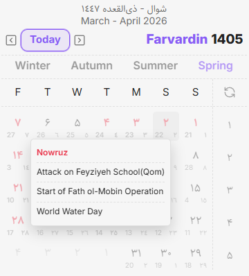
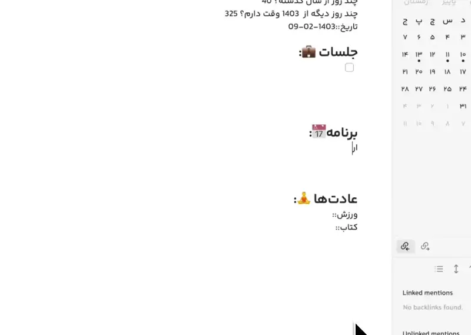

<div dir="ltr" align=center>

[**فارسی**](README_FA.md) / [**English**](README.md)

</div>

# "Persian Calendar" Plugin for Obsidian

<div align="center">
	
</div>

This plugin adds the Solar Hijri calendar alongside the Gregorian and Lunar Hijri calendars to
[Obsidian](https://obsidian.md/), offering Iranian users a more pleasant journaling experience.

- [Guide to the Essential Features](#guid)
- [Collaboration and Project Participation](#collaboration)

<div align="center">
	
	<div>Related to previous versions of the plugin</div>
</div>

## Installation Guide

### First method (recommended)

You can install this plugin by searching for `Persian Calendar` in Obsidian's `Community plugins`.

### Second method

You can visit the Releases section of this GitHub page, download the plugin's executable
files -`main.js`, `manifest.json` and `styles.css`- and move them to the following path:

`[Your Vault Address]/.obsidian/plugins/persian-calendar`

# <a name="guid"></a> Guide to the Essential Features

- [Dynamic Paths](#dynamic_path)
- [Quick Reference to Calendar Notes](#quick_reference)
- [Automatic links between periodic notes](#auto_links)
- [Placeholders](#placeholders)
- [Live Expressions](#live_expressions)
- [Custom Events](#custom_events)
- [Using the Dedicated API](#api)
- [Other Features](#other)

## <a name="dynamic_path"></a> Dynamic Paths and Naming

You can use dynamic placeholders to customize the paths and filenames of your calendar notes.

<div align="center">

| Placeholder | Example  | Description                          |
| :---------- | :------- | :----------------------------------- |
| `jYYYY`     | 1404     | Four-digit Jalali year               |
| `jYY`       | 04       | Two-digit Jalali year                |
| `YYYY`      | 2025     | Four-digit Gregorian year            |
| `YY`        | 25       | Two-digit Gregorian year             |
| `jQQQQ`     | Autumn   | Full Jalali season name              |
| `jQQ`       | 03       | Two-digit Jalali season number       |
| `jQ`        | 3        | Jalali season number                 |
| `jMMMM`     | Azar     | Full Jalali month name               |
| `jMMM`      | Aza      | Abbreviated Jalali month name        |
| `jMM`       | 09       | Two-digit Jalali month number        |
| `jM`        | 9        | Jalali month number                  |
| `MMMM`      | November | Full Gregorian month name            |
| `MMM`       | Nov      | Abbreviated Gregorian month name     |
| `MM`        | 11       | Two-digit Gregorian month number     |
| `M`         | 11       | Gregorian month number               |
| `jDD`       | 05       | Two-digit Jalali day of the month    |
| `jD`        | 5        | Jalali day of the month              |
| `DDDD`      | Monday   | Day of the week                      |
| `DD`        | 06       | Two-digit Gregorian day of the month |
| `D`         | 6        | Gregorian day of the month           |
| `ww`        | 49       | Two-digit week number                |
| `w`         | 49       | Week number                          |

</div>

The `w` and `ww` placeholders are week-number placeholders. They are resolved according to the
weekly note's configured week calculation (Jalali or Gregorian, and the selected week-start rule).
They are useful for weekly note paths and can also be used in daily note paths to place a daily note
under the corresponding week.

In folder paths, plain text is treated literally by default, and brackets (`[...]`) mark dynamic placeholders to be evaluated:

- `Daily` → interpreted literally as `Daily`
- `[D]aily` → interpreted as `D` + `aily` (e.g., `9aily`)
- `Journal/[jYYYY]/Daily` → interpreted as `Journal/1404/Daily`

In the daily note naming format, tokens (such as `YYYY-MM-DD` or `jYYYY-jMM-jDD`) are evaluated directly, and brackets escape literal text (e.g., `[Daily] YYYY-MM-DD`).

## <a name="quick_reference"></a> Quick Reference to Calendar Notes

Use `@` to insert a link to a calendar note, or `@/` to insert the resolved date as plain text
without creating a link.

- **Days:** `امروز`، `دیروز`، `فردا`، `پریروز`، `پس‌فردا`
- **Days of the week:** (نام روز جاری)، `روز بعد`، `روز قبل`
- **Weeks:** `این هفته`، `هفته قبل`، `هفته بعد`
- **Months:** `این ماه`، `ماه قبل`، `ماه بعد`
- **Seasons:** `این فصل`، `فصل قبل`، `فصل بعد`
- **Years:** `امسال`، `سال قبل`، `سال بعد`

You can also select the desired phrase in the text and link it to the corresponding note by
executing the related command.

<div align="center">
	
	<div>Related to previous versions of the plugin</div>
</div>

## <a name="auto_links"></a> Automatic links between periodic notes

Add `pc-auto-link` to the parent note’s frontmatter and list the types you want to include. For example, an Azar 1405 monthly note can request daily and weekly notes. If only these two daily notes exist, the plugin fills in `pc-links` as shown.

```yaml
---
pc-auto-link:
  - daily
  - weekly
pc-links:
  - "[[1405-09-01]]"
  - "[[1405-09-02]]"
---
```

| Parent note | Allowed entries in `pc-auto-link`        |
| ----------- | ---------------------------------------- |
| Weekly      | `daily`                                  |
| Monthly     | `daily`, `weekly`                        |
| Seasonal    | `daily`, `weekly`, `monthly`             |
| Yearly      | `daily`, `weekly`, `monthly`, `seasonal` |

A weekly note that overlaps two Jalali months, seasons, or years can appear in both parents’ `pc-links`, according to the calendar’s configured week calculation.

The plugin synchronizes links after notes are created, deleted, moved, renamed, or the selection changes. It includes only existing notes that match the calendar’s configured paths and names, and never creates a missing note.

## <a name="placeholders"></a> Placeholders

By inserting the following placeholders into your note templates, you can include your desired text
in the final result.

By typing `{{}}` you can receive suggestions for choosing your placeholder.

### Daily Note Placeholders

_Only replaced in daily notes._

<div align="center">

| Placeholder               | Sample Output      | Description                        |
| :------------------------ | :----------------- | :--------------------------------- |
| `{{تاریخ شمسی یادداشت}}`  | 1404-11-30         | Solar Hijri date of the daily note |
| `{{تاریخ میلادی یادداشت}}` | 2026-02-19         | Gregorian date of the daily note   |
| `{{تاریخ قمری یادداشت}}`  | 1447-09-01         | Lunar Hijri date of the daily note |
| `{{روز هفته یادداشت}}`    | پنجشنبه (Thursday) | Name of the day of the week        |
| `{{روز ماه یادداشت}}`     | 30                 | Day of the month                   |
| `{{مناسبت یادداشت}}`      | Event text         | Events of the daily note's date    |

</div>

### Weekly Placeholders

_Work in daily notes and weekly notes._

<div align="center">

| Placeholder              | Sample Output                   | Description                                                  |
| :----------------------- | :------------------------------ | :----------------------------------------------------------- |
| `{{هفته یادداشت}}`       | <span dir="ltr">1404-W49</span> | Week identifier                                              |
| `{{شماره هفته یادداشت}}` | 9                               | Note's week number according to the week calculation setting |
| `{{اول هفته}}`           | 2026-02-14                      | Start date of the week (Gregorian)                           |
| `{{آخر هفته}}`           | 2026-02-20                      | End date of the week (Gregorian)                             |

</div>

### Monthly Placeholders

_Work in daily notes and monthly notes._

<div align="center">

| Placeholder           | Sample Output | Description                         |
| :-------------------- | :------------ | :---------------------------------- |
| `{{ماه یادداشت}}`     | 1404-11       | Month identifier                    |
| `{{نام ماه یادداشت}}` | بهمن (Bahman) | Name of the Solar Hijri month       |
| `{{اول ماه}}`         | 2026-01-21    | Start date of the month (Gregorian) |
| `{{آخر ماه}}`         | 2026-02-19    | End date of the month (Gregorian)   |

</div>

### Seasonal Placeholders

_Work in daily notes, monthly notes, and seasonal notes._

<div align="center">

| Placeholder           | Sample Output                  | Description                          |
| :-------------------- | :----------------------------- | :----------------------------------- |
| `{{فصل یادداشت}}`     | <span dir="ltr">1404-S4</span> | Season identifier                    |
| `{{نام فصل یادداشت}}` | زمستان (Winter)                | Name of the season                   |
| `{{اول فصل}}`         | 2025-12-22                     | Start date of the season (Gregorian) |
| `{{آخر فصل}}`         | 2026-03-21                     | End date of the season (Gregorian)   |

</div>

### Yearly Placeholders

_Work in daily, weekly, monthly, and yearly notes._

<div align="center">

| Placeholder       | Sample Output | Description                        |
| :---------------- | :------------ | :--------------------------------- |
| `{{سال یادداشت}}` | 1404          | Solar Hijri year                   |
| `{{اول سال}}`     | 2025-03-21    | Start date of the year (Gregorian) |
| `{{آخر سال}}`     | 2026-03-20    | End date of the year (Gregorian)   |

</div>

### Current Time Placeholders

_These always return today's date, regardless of the note type._

<div align="center">

| Placeholder            | Sample Output                   | Description                                                   |
| :--------------------- | :------------------------------ | :------------------------------------------------------------ |
| `{{تاریخ شمسی جاری}}`  | 1404-11-26                      | Today's Solar Hijri date                                      |
| `{{تاریخ میلادی جاری}}` | 2026-02-15                      | Today's Gregorian date                                        |
| `{{تاریخ قمری جاری}}`  | 1447-08-26                      | Today's Lunar Hijri date                                      |
| `{{روز هفته جاری}}`    | یکشنبه (Sunday)                 | Name of today's weekday                                       |
| `{{روز ماه جاری}}`     | 26                              | Today's day of the month                                      |
| `{{هفته جاری}}`        | <span dir="ltr">1404-W49</span> | Current week identifier                                       |
| `{{شماره هفته جاری}}`  | 9                               | Current week number according to the week calculation setting |
| `{{نام ماه جاری}}`     | بهمن (Bahman)                   | Name of the current month                                     |
| `{{ماه جاری}}`         | 1404-11                         | Current month identifier                                      |
| `{{نام فصل جاری}}`     | زمستان (Winter)                 | Name of the current season                                    |
| `{{فصل جاری}}`         | <span dir="ltr">1404-S4</span>  | Current season identifier                                     |
| `{{سال جاری}}`         | 1404                            | Current year                                                  |
| `{{مناسبت جاری}}`      | Event text                      | Today's events                                                |

</div>

### Elapsed and Remaining Days

_By default, calculated relative to the daily note's date; if placed in a non-daily note, they use
today's date._

<div align="center">

| Placeholder                | Sample Output | Description                                   |
| :------------------------- | :------------ | :-------------------------------------------- |
| `{{روزهای گذشته سال}}`     | 334           | Days passed since the beginning of the year   |
| `{{روزهای باقیمانده سال}}` | 31            | Days remaining until the end of the year      |
| `{{روزهای گذشته فصل}}`     | 58            | Days passed since the beginning of the season |
| `{{روزهای باقیمانده فصل}}` | 31            | Days remaining until the end of the season    |
| `{{روزهای گذشته ماه}}`     | 28            | Days passed since the beginning of the month  |
| `{{روزهای باقیمانده ماه}}` | 2             | Days remaining until the end of the month     |

</div>

## <a name="live_expressions"></a> Live Expressions

Type `{+` in a note and choose a key from autocomplete. It inserts the exact `{+key}` syntax;
the Markdown source is never replaced. Reading View and Live Preview render the current Tehran
value (move the cursor outside an expression in Live Preview to see it).

Live Expressions differ from [placeholders](#placeholders), which write a static value when you
run the replacement command or create a note. They also differ from Smart Date Links, which
recognize date phrases and navigate to calendar notes. Live Expressions are display-only values
that stay current in an open rendered note.

```markdown
**Date** · {+نام روز} {+روز ماه شمسی} {+نام ماه شمسی} {+سال شمسی}
**Gregorian** · {+سال میلادی}-{+شماره ماه میلادی}-{+روز ماه میلادی}
**Tehran time** · {+ساعت}:{+دقیقه}
**Year elapsed** · {+درصد سال شمسی}%
**Today's events** · {+مناسبت}
```

<div dir="ltr">

| Use                       | Keys inside `{+…}`                                                                                              |
| ------------------------- | --------------------------------------------------------------------------------------------------------------- |
| Clock                     | `ساعت`, `دقیقه`, `ثانیه`                                                                                        |
| Jalali date               | `سال شمسی`, `نام ماه شمسی`, `شماره ماه شمسی`, `روز ماه شمسی`                                                    |
| Gregorian date            | `سال میلادی`, `نام ماه میلادی`, `شماره ماه میلادی`, `روز ماه میلادی`                                                |
| Lunar Hijri date          | `سال قمری`, `نام ماه قمری`, `شماره ماه قمری`, `روز ماه قمری`                                                    |
| Weekday and period        | `نام روز`, `شماره روز هفته`, `هفته سال`, `هفته ماه شمسی`, `فصل`, `شماره فصل`                                    |
| Length and position       | `تعداد روز سال شمسی`, `تعداد روز ماه شمسی`, `روز سال شمسی`, `روز فصل`                                           |
| Elapsed or remaining time | `روز باقی سال شمسی`, `روز باقی ماه شمسی`, `روز باقی فصل`, `روز باقی هفته`, `دقیقه مانده روز`, `دقیقه گذشته روز` |
| Numeric percentage        | `درصد سال شمسی`, `درصد فصل`, `درصد ماه شمسی`, `درصد هفته`, `درصد روز`                                           |
| Events and holidays       | `مناسبت`, `تعداد مناسبت`, `تعطیل`                                                                               |

</div>

Weekday numbers run from Saturday (1) to Friday (7). The week-of-year key uses your configured
week calculation; the week-of-month key counts days 1–7 as week 1, 8–14 as week 2, and so on.
Hijri dates use the selected Hijri basis. `تعطیل` is true on Friday or when an enabled event marks
the day as a holiday.

Under **Live Expressions** in Settings, choose an output language (Persian or English) for
generated names, event fallback text, and Yes/No values; choose Persian or English numerals
separately. The default is Persian text with English numerals, so all four combinations are
available. Custom-event titles remain authored text; only their rendered digits follow the numeral
setting. Built-in event titles use the selected language when the event data provides it.

Mounted expressions refresh on their normal second, minute, or Tehran-midnight cadence. They also
refresh after a committed custom-event cache update, when an event/display setting that affects
them changes, and when Obsidian returns from the background or sleep. This recalculates from the
current time without polling or changing Markdown files.

Autocomplete for named expressions is bidirectionally
isolated, so Persian keys display as `{+کلید}` in both RTL and LTR interfaces while insertion
preserves the exact Markdown text.

### Live Countdowns

Type a Jalali date with ASCII digits inside `{+…}`. Times use the 24-hour clock in Tehran.
A date alone means midnight, and omitted seconds default to zero.

| Use                       | One-time target          | Annual target       |
| ------------------------- | ------------------------ | ------------------- |
| Start of Nowruz           | `{+1405-01-01}`          | `{+01-01}`          |
| Birthday lunch            | `{+1405-06-15 13:30}`    | `{+06-15 13:30}`    |
| Anniversary to the second | `{+1405-09-10 18:45:30}` | `{+09-10 18:45:30}` |

A one-time target shows time remaining, displays **Now** at the target second, then shows
time elapsed. An annual target switches to its next occurrence when reached. For example,
`{+12-30}` skips years without Esfand 30. Durations update every second as a compact clock:
**6 days, 10:40:30 remaining** or, when days are zero, **02:15:08 remaining**. The Live
Expressions language and numeral settings control the display. Invalid targets stay visible as typed.

## <a name="custom_events"></a> Custom Event Repositories

At the end of the **Event Display** section, click **Add Custom Events**. In the dialog that opens, select a note and save it.

Define each event on a plain line using the format `Date | Title | Color | Holiday`. Dates must use ASCII digits and hyphens: `MM-DD` dates recur annually in the selected calendar, while `YYYY-MM-DD` dates appear only in the specified year.

The color field is optional and determines the event's accent border color in the tooltip, based on the active Obsidian theme. Supported colors are `red`, `orange`, `yellow`, `green`, `cyan`, `blue`, `purple`, and `pink`. Omit it to use the default primary color; invalid colors are rejected.

To mark an event as a holiday, enter `تعطیل` in the fourth field.

To keep the default color while marking an event as a holiday, use the following format: `Date | Title | | تعطیل`.

## <a name="api"></a> Using the Dedicated API

This plugin provides a public API so you can use features like date and number conversion in other
plugins and scripts (such as DataviewJS or Templater).

<div dir="ltr">

```javascript
const pcApi = app.plugins.getPlugin("persian-calendar").api;

// Number conversion
pcApi.toEnNumber("۱۲۳ تست test"); // "123 تست test"
pcApi.toFaNumber("123 تست test"); // "۱۲۳ تست test"

// Solar Hijri date conversion
pcApi.jalaliToDate(1405, 9, 13); // Equivalent Gregorian date as Date object
pcApi.jalaliToGregorian(1405, 9, 13); // {gy: 2026, gm: 12, gd: 4}
pcApi.jalaliToHijri(1405, 9, 13); // (Iran basis) {hy: 1448, hm: 6, hd: 24}
pcApi.jalaliToHijri(1405, 9, 13, { base: "umalqura" }); // (Umm al-Qura basis) {hy: 1448, hm: 6, hd: 24}
pcApi.jalaliMonthName(9); // آذر (Azar)
pcApi.jalaliMonthName(9, "en"); // Azar
pcApi.seasonName(3); // پاییز (Autumn)
pcApi.seasonName(3, "en"); // Autumn

// Gregorian date conversion
pcApi.dateToGregorian(new Date()); // {gy, gm, gd}
pcApi.gregorianToDate(2026, 12, 4); // Date object
pcApi.gregorianToJalali(2026, 12, 4); // {jy: 1405, jm: 9, jd: 13}
pcApi.gregorianToHijri(2026, 12, 4); // (Iran) {hy: 1448, hm: 6, hd: 24}
pcApi.gregorianToHijri(2026, 12, 4, { base: "umalqura" }); // (Umm al-Qura basis) {hy: 1448, hm: 6, hd: 24}

// Lunar Hijri date conversion (Iran basis)
pcApi.hijriToDate(1448, 6, 24); // Date object
pcApi.hijriToGregorian(1448, 6, 24); // {gy: 2026, gm: 12, gd: 4}
pcApi.hijriToJalali(1448, 6, 24); // {jy: 1405, jm: 9, jd: 13}

// Lunar Hijri date conversion (Umm al-Qura basis)
pcApi.hijriToDate(1448, 6, 24, { base: "umalqura" }); // Date object
pcApi.hijriToGregorian(1448, 6, 24, { base: "umalqura" }); // {gy: 2026, gm: 12, gd: 4}
pcApi.hijriToJalali(1448, 6, 24, { base: "umalqura" }); // {jy: 1405, jm: 9, jd: 13}

// Events
pcApi.checkHoliday(new Date()); // Is it a holiday? true/false
pcApi.dateToEvents(new Date()); // Array of {title(fa/en), categories, isHolidayInIran}
pcApi.dateToEvents(new Date(), { base: "umalqura" }); // With Umm al-Qura basis
```

</div>

## <a name="other"></a> Other Features

<div align="center">
	
</div>

- scales responsively with the sidebar width
- Display of official Iranian holidays on the calendar
- Display of Iran's official calendar events and international observances
- Option to "Open today's daily note on startup," user configurable
- Customizable display of calendar events
- Option to create and display seasonal notes, user configurable
- Choose whether weekly notes use the Gregorian or Jalali week numbering system.
- For better compatibility with other Gregorian calendar plugins, you can use Gregorian naming for Jalali monthly and yearly notes.
- Confirmation dialog before creating calendar notes, user configurable
- Option to set the user interface to Persian or English
- Ability to configure calendar note templates
- Ability to set the Lunar Hijri calendar based on **Iran's Crescent Committee** or **Saudi Arabia's
  Umm al-Qura**
- Option to display the Gregorian or Lunar Hijri calendar as supplementary calendars
- Ability to use a dedicated date picker when setting a property with type `date`
- Users can use this plugin's [default font](https://github.com/rastikerdar/sahel-font) named
  "Persian Calendar"

</div>

## <a name="collaboration"></a> Collaboration and Project Participation

This plugin has been developed with love, for non-commercial purposes, and under
[this license](LICENSE).

You can support our continued efforts in the following ways:

- Contribute to the development of this plugin
- Report bugs or suggest a feature for development via the Issues section on this GitHub page
- Recommend installing and using this plugin to your friends
- Follow our website and Telegram channel

<div align=center>

[](https://karfekr.ir)
[](https://t.me/karfekr)
[](https://t.me/ObsidianFarsi)

</div>
