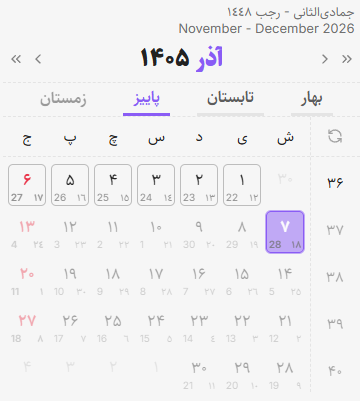
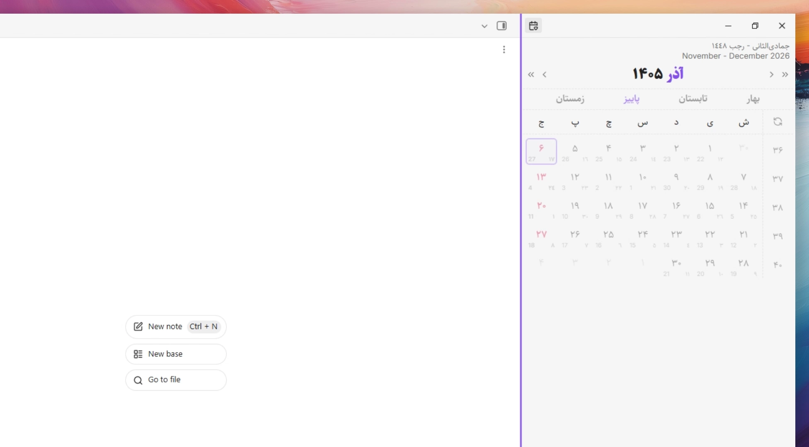
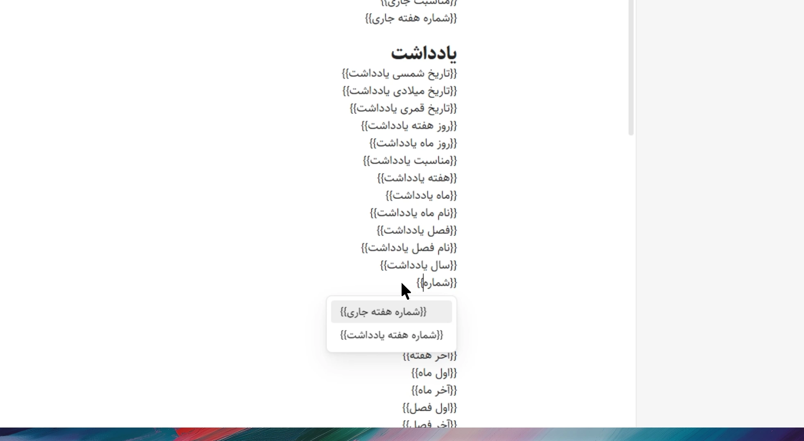
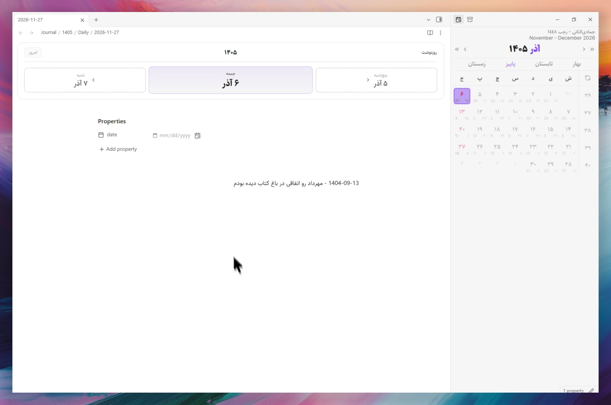
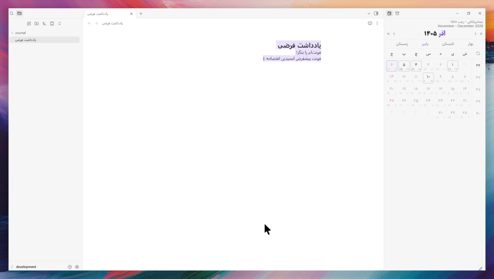

<p align="center" dir="ltr">
  <strong><a href="README_FA.md">فارسی</a></strong> · <a href="README.md">English</a>
</p>

<div dir="rtl" lang="fa">

# <a name="افزونه‌ی-تقویم-فارسی-برای-obsidian"></a> افزونهٔ تقویم فارسی برای ابسیدین

با تقویم هجری شمسی در [ابسیدین](https://obsidian.md/) یادداشت‌های دوره‌ای را باز کنید، تعطیلات را ببینید و با تاریخ‌ها کار کنید. رابط افزونه به فارسی و انگلیسی در دسترس است.

[نصب](#راهنمای-نصب-افزونه) · [راهنمای امکانات](#guid) · [مشارکت](#collaboration)

<div align="center">



</div>

## راهنمای نصب افزونه

### <a name="راه-اولپیشنهادی"></a> نصب از فهرست افزونه‌ها

در بخش <span dir="ltr">Settings → Community plugins → Browse</span> نام <span dir="ltr">Persian Calendar</span> را جست‌وجو کنید و به‌ترتیب روی **Install** و **Enable** بزنید. [صفحهٔ افزونه در ابسیدین](https://community.obsidian.md/plugins/persian-calendar)

### <a name="راه-دوم"></a> نصب دستی

فایل‌های <code dir="ltr">main.js</code>، <code dir="ltr">manifest.json</code> و <code dir="ltr">styles.css</code> را از [بخش انتشارهای گیت‌هاب](https://github.com/karfekr/obsidian-persian-calendar/releases) دریافت کنید. آن‌ها را در پوشهٔ <code dir="ltr">.obsidian/plugins/persian-calendar/</code> در مخزن یادداشت‌هایتان قرار دهید، ابسیدین را دوباره باز کنید و افزونهٔ <span dir="ltr">Persian Calendar</span> را در **Community plugins** فعال کنید.

## <a name="guid"></a><a name="راهنمای-امکانات-اساسی-این-افزونه"></a> راهنمای امکانات

[تقویم](#other) · [مسیر و نام‌گذاری](#dynamic_path) · [ارجاع سریع](#quick_reference) · [پیوند خودکار](#auto_links)<br />
[عبارت‌های معنادار](#placeholders) · [عبارت‌های زنده](#live_expressions) · [مناسبت‌های سفارشی](#custom_events)<br />
[انتخاب تاریخ](#date-picker) · [قلم فارسی](#persian-font) · [رابط برنامه‌نویسی](#api)

### <a name="other"></a><a name="دیگر-امکانات"></a> تقویم و جابه‌جایی میان یادداشت‌ها

فرمان **باز کردن تقویم فارسی** را از فهرست فرمان‌ها اجرا کنید. روی روز، شمارهٔ هفته، ماه، فصل یا سال بزنید تا یادداشت آن باز یا ساخته شود. در بخش **تقویم‌های مکمل** می‌توانید تاریخ میلادی یا قمری را نمایش دهید و مبنای تقویم قمری (استهلال ایران یا ام‌القری) را انتخاب کنید.

<div align="center">



</div>

وقتی ماه دیگری را می‌بینید، با دکمهٔ **این ماه** در بالای تقویم به ماه جاری برگردید. با فعال کردن **نمایش ناوبری داخل یادداشت** می‌توانید از همان یادداشت دوره‌ای به دورهٔ قبل، بعد یا جاری بروید.

<div align="center">


</div>

### <a name="dynamic_path"></a><a name="مسیردهی-و-نام-پویا"></a> مسیر و نام‌گذاری پویا

پوشه‌ها را در بخش **مسیر یادداشت‌های تقویم** و قالب نام فایل روزنوشت را در بخش **نام‌گذاری یادداشت‌های تقویم** تنظیم کنید. نمونه‌های زیر برای ۱ آذر ۱۴۰۵ (۲۲ نوامبر ۲۰۲۶) هستند.

| تنظیم                                               | الگو                                         | نتیجه                                     |
| --------------------------------------------------- | -------------------------------------------- | ----------------------------------------- |
| مسیر پوشه · نشانه‌های تاریخ را داخل براکت بگذارید    | <code dir="ltr">Journal/[jYYYY]/Daily</code> | <code dir="ltr">Journal/1405/Daily</code> |
| نام فایل روزنوشت · نشانه‌های تاریخ را مستقیم بنویسید | <code dir="ltr">jYYYY-jMM-jDD</code>         | <code dir="ltr">1405-09-01</code>         |
| نام فایل روزنوشت · متن ثابت را داخل براکت بگذارید   | <code dir="ltr">[Daily] YYYY-MM-DD</code>    | <code dir="ltr">Daily 2026-11-22</code>   |

برای درج شمارهٔ هفته طبق تنظیمات، از <code dir="ltr">w</code> یا <code dir="ltr">ww</code> استفاده کنید، مثل <code dir="ltr">Journal/[jYYYY]/W[ww]</code>. روش محاسبهٔ هفته و نام‌گذاری ماه‌نوشت و سال‌نوشت را هم می‌توانید در بخش **نام‌گذاری یادداشت‌های تقویم** روی شمسی یا میلادی بگذارید. [فهرست نشانه‌های تاریخ (انگلیسی)](docs/date-engine.md#supported-token-registry-srcutilsdateenginetokens)

### <a name="quick_reference"></a> ارجاع سریع به یادداشت‌های تقویم

<code dir="ltr">@</code> را تایپ کنید و عبارتی مثل «امروز» یا «این هفته» را از پیشنهادها برگزینید تا پیوند یادداشت درج شود. با <code dir="ltr">@/</code> تاریخ یا شناسهٔ دوره به‌صورت متن ساده درج می‌شود. برای روزها، نام روزهای هفته، هفته‌ها، ماه‌ها، فصل‌ها و سال‌ها پیشنهادهایی در دسترس است.

<div align="center">


</div>

### <a name="auto_links"></a> پیوند خودکار یادداشت‌های دوره‌ای

در ویژگی <code dir="ltr">pc-auto-link</code> یادداشت مادر، نوع یادداشت‌های دلخواه را به‌صورت فهرست بنویسید. افزونه پیوند یادداشت‌های متناظرِ موجود در مخزن را در <code dir="ltr">pc-links</code> به‌روز نگه می‌دارد. برای نمونه، اگر تنها یادداشت‌های متناظر با ماه‌نوشت آذر ۱۴۰۵ همین دو روزنوشت باشند، ویژگی‌ها به این شکل درمی‌آیند.

<div dir="ltr">

```yaml
---
pc-auto-link:
  - daily
  - weekly
pc-links:
  - "[[1405-09-01]]"
  - "[[1405-09-02]]"
---
```

</div>

| یادداشت مادر | مقدارهای مجاز در <code dir="ltr">pc-auto-link</code> |
| ------------ | ---------------------------------------------------- |
| هفته‌نوشت     | `daily`                                              |
| ماه‌نوشت      | `daily`، `weekly`                                    |
| فصل‌نوشت      | `daily`، `weekly`، `monthly`                         |
| سال‌نوشت      | `daily`، `weekly`، `monthly`، `seasonal`             |

اگر هفته‌ای در دو ماه، فصل یا سال شمسی قرار بگیرد، پیوند هفته‌نوشت می‌تواند در هر دو یادداشت مادر بیاید.

<div align="center">


</div>

### <a name="placeholders"></a> عبارت‌های معنادار

برای دیدن پیشنهادها، <code dir="ltr">{{</code> را تایپ کنید. عبارت‌ها را در قالبی که در بخش **قالب یادداشت‌های تقویم** انتخاب کرده‌اید بگذارید تا هنگام ساخت یادداشت با مقدار ثابت جایگزین شوند. در یادداشت موجود، فرمان **جایگزینی عبارات معنادار** را اجرا کنید.

<div dir="ltr">

```text
{{تاریخ شمسی یادداشت}}
{{روز هفته یادداشت}}
{{مناسبت یادداشت}}
```

</div>

<div align="center">



</div>

<details>
<summary>فهرست عبارت‌های معنادار</summary>

از عبارت‌های مربوط به تاریخ یا دورهٔ یادداشت استفاده کنید، یا با عبارت‌های زمان جاری مقدارهای امروز را هنگام جایگزینی ثبت کنید. مبنای محاسبهٔ روزهای گذشته و باقی‌مانده، تاریخ یادداشت است و اگر تاریخ یادداشت قابل تشخیص نباشد، تاریخ امروز به کار می‌رود.

#### عبارات وابسته به روزنوشت

<code dir="ltr">{{تاریخ شمسی یادداشت}}</code>، <code dir="ltr">{{تاریخ میلادی یادداشت}}</code>، <code dir="ltr">{{تاریخ قمری یادداشت}}</code>، <code dir="ltr">{{روز هفته یادداشت}}</code>، <code dir="ltr">{{روز ماه یادداشت}}</code>، <code dir="ltr">{{مناسبت یادداشت}}</code>

#### عبارات وابسته به هفته

<code dir="ltr">{{هفته یادداشت}}</code>، <code dir="ltr">{{شماره هفته یادداشت}}</code>، <code dir="ltr">{{اول هفته}}</code>، <code dir="ltr">{{آخر هفته}}</code>

#### عبارات وابسته به ماه

<code dir="ltr">{{ماه یادداشت}}</code>، <code dir="ltr">{{نام ماه یادداشت}}</code>، <code dir="ltr">{{اول ماه}}</code>، <code dir="ltr">{{آخر ماه}}</code>

#### عبارات وابسته به فصل

<code dir="ltr">{{فصل یادداشت}}</code>، <code dir="ltr">{{نام فصل یادداشت}}</code>، <code dir="ltr">{{اول فصل}}</code>، <code dir="ltr">{{آخر فصل}}</code>

#### عبارات وابسته به سال

<code dir="ltr">{{سال یادداشت}}</code>، <code dir="ltr">{{اول سال}}</code>، <code dir="ltr">{{آخر سال}}</code>

#### عبارات زمان جاری

<code dir="ltr">{{تاریخ شمسی جاری}}</code>، <code dir="ltr">{{تاریخ میلادی جاری}}</code>، <code dir="ltr">{{تاریخ قمری جاری}}</code>، <code dir="ltr">{{روز هفته جاری}}</code>، <code dir="ltr">{{روز ماه جاری}}</code>، <code dir="ltr">{{هفته جاری}}</code>، <code dir="ltr">{{شماره هفته جاری}}</code>، <code dir="ltr">{{نام ماه جاری}}</code>، <code dir="ltr">{{ماه جاری}}</code>، <code dir="ltr">{{نام فصل جاری}}</code>، <code dir="ltr">{{فصل جاری}}</code>، <code dir="ltr">{{سال جاری}}</code>، <code dir="ltr">{{مناسبت جاری}}</code>

#### روزهای گذشته و باقی‌مانده

<code dir="ltr">{{روزهای گذشته سال}}</code>، <code dir="ltr">{{روزهای باقیمانده سال}}</code>، <code dir="ltr">{{روزهای گذشته فصل}}</code>، <code dir="ltr">{{روزهای باقیمانده فصل}}</code>، <code dir="ltr">{{روزهای گذشته ماه}}</code>، <code dir="ltr">{{روزهای باقیمانده ماه}}</code>

</details>

### <a name="live_expressions"></a> عبارت‌های زنده

<code dir="ltr">{+</code> را تایپ کنید و یک کلید از پیشنهادها انتخاب کنید. تاریخ، ساعت تهران یا مناسبت‌ها در حالت خواندن و پیش‌نمایش زنده به‌روز می‌مانند. در پیش‌نمایش زنده، نشانگر را از روی عبارت بردارید تا مقدارش را ببینید. در تنظیمات **عبارت‌های زنده** می‌توانید زبان خروجی و نوع رقم‌ها را جداگانه تعیین کنید.

<div dir="ltr">

```markdown
**تاریخ** · {+نام روز} {+روز ماه شمسی} {+نام ماه شمسی} {+سال شمسی}
**تاریخ میلادی** · {+سال میلادی}-{+شماره ماه میلادی}-{+روز ماه میلادی}
**ساعت تهران** · {+ساعت}:{+دقیقه}
**درصد سپری‌شدهٔ سال** · {+درصد سال شمسی}%
**مناسبت‌های امروز** · {+مناسبت}
```

</div>

<div align="center">


</div>

#### شمارش معکوس زنده

تاریخ شمسی را با رقم‌های <code dir="ltr">0–9</code> بنویسید و در صورت نیاز، ساعت را به‌صورت ۲۴ساعته و به وقت تهران وارد کنید. اگر ساعت را ننویسید، موعد نیمه‌شب است. پس از موعد، شمارش یک‌باره زمان سپری‌شده را نشان می‌دهد و شمارش سالانه تا نوبت بعدی ادامه پیدا می‌کند.

| نمونه               | یک‌باره                                        | سالانه                                    |
| ------------------- | --------------------------------------------- | ---------------------------------------- |
| نوروز               | <code dir="ltr">{+1405-01-01}</code>          | <code dir="ltr">{+01-01}</code>          |
| ناهار تولد          | <code dir="ltr">{+1405-06-15 13:30}</code>    | <code dir="ltr">{+06-15 13:30}</code>    |
| سالگرد با دقت ثانیه | <code dir="ltr">{+1405-09-10 18:45:30}</code> | <code dir="ltr">{+09-10 18:45:30}</code> |

<details>
<summary>کلیدهای عبارت‌های زنده</summary>

| کاربرد                    | کلیدهای داخل <code dir="ltr">{+…}</code>                                                                        |
| ------------------------- | --------------------------------------------------------------------------------------------------------------- |
| ساعت                      | `ساعت`، `دقیقه`، `ثانیه`                                                                                        |
| تاریخ شمسی                | `سال شمسی`، `نام ماه شمسی`، `شماره ماه شمسی`، `روز ماه شمسی`                                                    |
| تاریخ میلادی               | `سال میلادی`، `نام ماه میلادی`، `شماره ماه میلادی`، `روز ماه میلادی`                                                |
| تاریخ قمری                | `سال قمری`، `نام ماه قمری`، `شماره ماه قمری`، `روز ماه قمری`                                                    |
| روز هفته و دوره           | `نام روز`، `شماره روز هفته`، `هفته سال`، `هفته ماه شمسی`، `فصل`، `شماره فصل`                                    |
| شمار روزها                | `تعداد روز سال شمسی`، `تعداد روز ماه شمسی`، `روز سال شمسی`، `روز فصل`                                           |
| زمان باقی‌مانده یا سپری‌شده | `روز باقی سال شمسی`، `روز باقی ماه شمسی`، `روز باقی فصل`، `روز باقی هفته`، `دقیقه مانده روز`، `دقیقه گذشته روز` |
| درصد سپری‌شده              | `درصد سال شمسی`، `درصد فصل`، `درصد ماه شمسی`، `درصد هفته`، `درصد روز`                                           |
| مناسبت‌ها و تعطیلات         | `مناسبت`، `تعداد مناسبت`، `تعطیل`                                                                               |

</details>

### <a name="custom_events"></a><a name="مخزن‌های-مناسبت‌های-سفارشی"></a> مناسبت‌های سفارشی

در تقویم می‌توانید تعطیلات و مناسبت‌های رسمی ایران، مناسبت‌های جهانی و مناسبت‌های خودتان را ببینید. در بخش **نمایش مناسبت‌ها**، گزینهٔ **نمایش مناسبت‌های سفارشی** را فعال کنید و روی **افزودن مناسبت‌های سفارشی** بزنید. یادداشت و مبنای تاریخ‌های آن (شمسی، میلادی یا قمری) را انتخاب و ذخیره کنید.

هر مناسبت را در یک خط از یادداشت بنویسید. تاریخ‌های نمونهٔ زیر شمسی‌اند. برای مناسبت‌های سالانه از <code dir="ltr">MM-DD</code> و برای مناسبت‌های یک‌باره از <code dir="ltr">YYYY-MM-DD</code> استفاده کنید. تاریخ را با رقم‌های <code dir="ltr">0–9</code> و خط تیره بنویسید.

<div dir="ltr">

```text
06-15 | تولد | purple
1405-09-10 | تعطیلی دفتر | | تعطیل
```

</div>

در بخش سوم می‌توانید یکی از رنگ‌های `red`، `orange`، `yellow`، `green`، `cyan`، `blue`، `purple` یا `pink` را بنویسید. برای ثبت تعطیلی، در بخش چهارم `تعطیل` بنویسید. با خالی گذاشتن بخش سوم، رنگ پیش‌فرض به کار می‌رود.

<div align="center">


</div>

### <a name="date-picker"></a> انتخاب تاریخ

برای انتخاب تاریخ شمسی، روی نماد تقویم کنار ویژگیِ نوع **Date** بزنید. برای درج یا تبدیل تاریخ در متن یادداشت، فرمان **درج و تبدیل تاریخ** را اجرا کنید.

<div align="center">



</div>

### <a name="persian-font"></a> قلم فارسی

[قلم ساحل](https://github.com/rastikerdar/sahel-font) با نام <span dir="ltr">Persian Calendar</span> همراه افزونه ارائه می‌شود. برای استفاده در یادداشت‌ها، به <span dir="ltr">Settings → Appearance → Text font</span> بروید، روی **Manage** بزنید و قلم <span dir="ltr">Persian Calendar</span> را اضافه کنید.

<div align="center">



</div>

### <a name="api"></a><a name="استفاده-از-api-اختصاصی"></a> رابط برنامه‌نویسی افزونه

می‌توانید از رابط برنامه‌نویسی افزونه در افزونه‌های دیگر یا اسکریپت‌هایی مثل DataviewJS و Templater استفاده کنید. [فهرست کامل توابع تبدیل تاریخ، تبدیل رقم‌ها و دریافت مناسبت‌ها (انگلیسی)](docs/architecture.md#public-plugin-api-apiservice)

<div dir="ltr">

```javascript
const pcApi = app.plugins.getPlugin("persian-calendar").api;

// تبدیل اعداد
pcApi.toEnNumber("۱۲۳ تست test"); // "123 تست test"
pcApi.toFaNumber("123 تست test"); // "۱۲۳ تست test"

// تبدیل تاریخ شمسی
pcApi.jalaliToDate(1405, 9, 13); // تاریخ میلادی معادل به‌صورت Date
pcApi.jalaliToGregorian(1405, 9, 13); // {gy: 2026, gm: 12, gd: 4}
pcApi.jalaliToHijri(1405, 9, 13); // (مبنای ایران) {hy: 1448, hm: 6, hd: 24}
pcApi.jalaliToHijri(1405, 9, 13, { base: "umalqura" }); // (مبنای ام‌القری) {hy: 1448, hm: 6, hd: 24}
pcApi.jalaliMonthName(9); // آذر
pcApi.jalaliMonthName(9, "en"); // Azar
pcApi.seasonName(3); // پاییز
pcApi.seasonName(3, "en"); // Autumn

// تبدیل تاریخ میلادی
pcApi.dateToGregorian(new Date()); // {gy, gm, gd}
pcApi.gregorianToDate(2026, 12, 4); // Date
pcApi.gregorianToJalali(2026, 12, 4); // {jy: 1405, jm: 9, jd: 13}
pcApi.gregorianToHijri(2026, 12, 4); // (ایران) {hy: 1448, hm: 6, hd: 24}
pcApi.gregorianToHijri(2026, 12, 4, { base: "umalqura" }); // (ام‌القری) {hy: 1448, hm: 6, hd: 24}

// تبدیل تاریخ قمری (مبنای ایران)
pcApi.hijriToDate(1448, 6, 24); // Date
pcApi.hijriToGregorian(1448, 6, 24); // {gy: 2026, gm: 12, gd: 4}
pcApi.hijriToJalali(1448, 6, 24); // {jy: 1405, jm: 9, jd: 13}

// تبدیل تاریخ قمری (مبنای ام‌القری)
pcApi.hijriToDate(1448, 6, 24, { base: "umalqura" }); // Date
pcApi.hijriToGregorian(1448, 6, 24, { base: "umalqura" }); // {gy: 2026, gm: 12, gd: 4}
pcApi.hijriToJalali(1448, 6, 24, { base: "umalqura" }); // {jy: 1405, jm: 9, jd: 13}

// مناسبت‌ها
pcApi.checkHoliday(new Date()); // آیا روز تعطیل است؟ true/false
pcApi.dateToEvents(new Date()); // آرایه‌ای از {title(fa/en), categories, isHolidayInIran}
pcApi.dateToEvents(new Date(), { base: "umalqura" }); // با مبنای ام‌القری
```

</div>

## <a name="collaboration"></a><a name="همراهی-و-مشارکت-در-پروژه"></a> مشارکت

برای همکاری، [راهنمای مشارکت](CONTRIBUTING_FA.md) را بخوانید. برای گزارش خطا یا پیشنهاد قابلیت، از [بخش Issues گیت‌هاب](https://github.com/karfekr/obsidian-persian-calendar/issues) استفاده کنید. افزونه با مجوز [GPL-3.0](LICENSE) منتشر می‌شود.

<div align="center">

[](https://karfekr.ir)
[](https://t.me/karfekr)
[](https://t.me/ObsidianFarsi)

</div>

</div>
