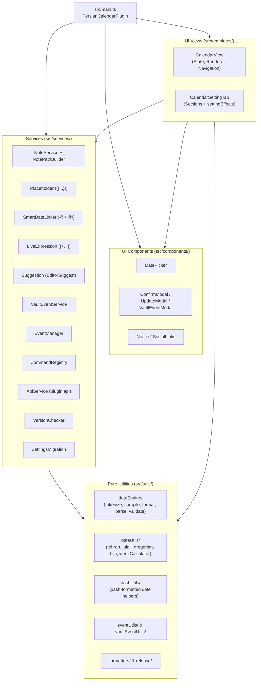

# Architecture

This document describes the high-level architecture, lifecycle, module boundaries, and public API of **Obsidian Persian Calendar**.

## System Overview

The plugin follows a layered architecture inspired by `notebook-navigator`, `Templater`, and `obsidian-journal`:



### Architectural Principles

- **`src/utils/` is pure and Obsidian-free** (except `normalizePath` is only used in services, not utils). This keeps date math, pattern compilation, event matching, and vault-note parsing fast and directly unit-testable in Node via Vitest.
- **`src/services/` orchestrates Obsidian APIs** (`Vault`, `Workspace`, `FileManager`, `EditorSuggest`, `MarkdownPostProcessor`, CodeMirror 6 extensions) and connects user settings to pure utilities.
- **`src/templates/` owns Obsidian views** (`CalendarView` and `CalendarSettingTab`), delegating state, rendering, and side effects to focused sub-modules.
- **`src/components/` holds reusable modals and UI widgets** (`DatePicker`, `ConfirmModal`, `UpdateModal`, `VaultEventModal`, `Notice`, `SocialLinks`).
- **`src/types/index.ts`** is the single source of truth for shared domain types (`TJalali`, `TGregorian`, `THijri`, `TSetting`, `TCustomEvent`, `TDateEngineContext`, etc.).

---

## Plugin Lifecycle (`src/main.ts`)

`PersianCalendarPlugin` extends Obsidian's `Plugin` class.

### 1. Constructor

Instantiates editor-facing services that are referenced early:

- `this.placeholder = new Placeholder(this)`
- `this.liveExpression = new LiveExpression(this)` (registers `visibilitychange` and `focus` resume listeners)

### 2. `onload()` Startup Sequence

Executed in strict order:

1. `initializeServices()`: creates `CommandRegistry`, `EventManager`, `VaultEventService`, and `VersionChecker`.
2. `await loadSetting()`: loads `data.json`, runs `applySettingsMigrations(data)`, calls `setLocal(this.setting.language)`, and persists migrated settings if migration flags (`legacyPathPatternsMigrated`, `bracketedPathPatternsMigrated`) were not yet set.
3. `setAdapter(setDefaultEventAdapter())`: configures `persian-holidays` with the `iran-estehlal` Hijri adapter.
4. Instantiates `ApiService` (reading live settings and `getAllCustomEvents()`) and `NoteService`.
5. Registers the `"persian-calendar"` sidebar view (`CalendarView`).
6. Registers `workspace.onLayoutReady(...)` callback:
   - Opens today's daily note if `setting.openDailyNoteOnStartup` is enabled.
   - Calls `vaultEventService.refresh()` and refreshes calendar views when custom vault events finish loading.
   - Activates `"persian-calendar"` in the right sidebar if no leaf of that type exists yet.
7. Attaches a `MutationObserver` on `activeDocument.body` to inject the Jalali `DatePicker` button into Obsidian date metadata fields (`.metadata-property-value[data-property-type="date"]`), with cleanup registered via `this.register()`.
8. Registers unified `EditorSuggest` (`Suggestion`) with three providers in priority order:
   1. `SmartDateLinker` (`@` / `@/`)
   2. `Placeholder` (`{{...`)
   3. `LiveExpression` (`{+...`)
9. Registers Live Expressions for both Reading View (`registerMarkdownPostProcessor`) and Live Preview (`registerEditorExtension` with CodeMirror 6 `ViewPlugin`).
10. Registers vault event listeners (`eventManager.registerEvents()`), settings tab (`CalendarSettingTab`), and commands (`commandRegistry.init()`).
11. Runs `await versionChecker.checkForVersionUpdate()` to show `UpdateModal` when upgrading across documented versions.
12. Builds and freezes the public API at `this.api = this.apiService.build()`.

### 3. `onunload()` Teardown

- Calls `this.liveExpression.destroy()` to clear all active cadence timers (`second`, `minute`, `day`) and remove `visibilitychange` / `focus` listeners.
- Detaches all `"persian-calendar"` workspace leaves.
- Obsidian automatically cleans up registered events, commands, editor extensions, and `this.register()` callbacks (including the `MutationObserver`).

---

## Module Boundaries

| Directory         | Responsibility                                                                                                                   | Allowed Dependencies                                                                                                        |
| ----------------- | -------------------------------------------------------------------------------------------------------------------------------- | --------------------------------------------------------------------------------------------------------------------------- |
| `src/types/`      | Shared TypeScript types and unions                                                                                               | `@internationalized/date` (types), `obsidian` (types), `src/constants/` (types)                                             |
| `src/constants/`  | Default settings, localized month/weekday/season names, regexes, colors, release notes, social links                             | `src/types/`                                                                                                                |
| `src/languages/`  | `t(key)`, `setLocal(lang)`, `getLocal()`, `getDirection()`, `onLocalChange(cb)` + `en.json` / `fa.json`                          | `src/types/`                                                                                                                |
| `src/utils/`      | Pure calendar math, Date Engine, dash helpers, event lookup, vault-note parsing, number/date formatters, release-note comparison | External math/holiday deps (`@internationalized/date`, `iran-estehlal`, `persian-holidays`), `src/constants/`, `src/types/` |
| `src/services/`   | Obsidian-integrated services, note management, editor extensions, vault caching                                                  | `obsidian`, `@codemirror/*`, `src/utils/`, `src/components/`, `src/languages/`, `src/constants/`, `src/types/`              |
| `src/components/` | Reusable modals & small UI components                                                                                            | `obsidian`, `src/utils/`, `src/languages/`, `src/constants/`, `src/types/`                                                  |
| `src/templates/`  | Full views: `CalendarView/` and `Setting/`                                                                                       | `obsidian`, `src/services/`, `src/components/`, `src/utils/`, `src/languages/`, `src/constants/`, `src/types/`              |

---

## Public Plugin API (`ApiService`)

External plugins or Templater/DataviewJS scripts can access the frozen API object at:

```ts
app.plugins.plugins["persian-calendar"].api;
```

Built by `src/services/ApiService/index.ts`, it exposes:

- **Number conversion:** `toEnNumber`, `toFaNumber`
- **Gregorian conversions:** `dateToGregorian`, `gregorianToDate`, `gregorianToJalali`, `gregorianToHijri`
- **Jalali conversions:** `dateToJalali`, `jalaliToDate`, `jalaliToGregorian`, `jalaliToHijri`, `jalaliMonthLength`, `jalaliMonthName`, `seasonName`
- **Hijri conversions:** `dateToHijri`, `hijriToDate`, `hijriToGregorian`, `hijriToJalali`, `hijriMonthLength` (accepts `{ base?: "iran" | "umalqura" }`)
- **Holidays & Events:** `checkHoliday(date)`, `dateToEvents(date, options?)` (respects current `hijriBase` and `showCustomEvents` / vault events)

> **Timezone contract:** All `Date`-accepting API methods convert incoming JS `Date` objects via `calendarDateFromDate(date)` (interpreted in `Asia/Tehran`), and all `*ToDate` methods return UTC-noon `Date` objects via `calendarDateToDate(...)` to prevent off-by-one shifts across client timezones.
