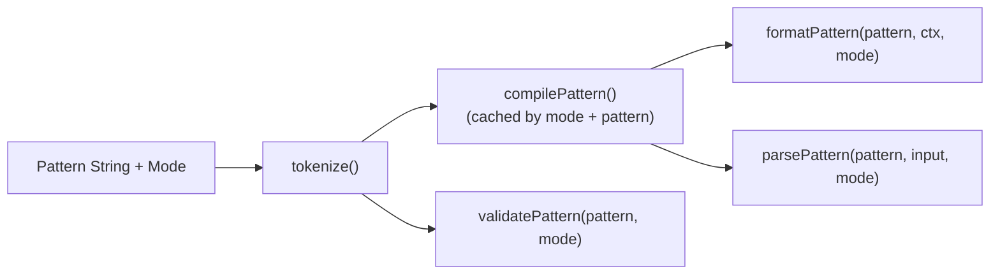

# Date Engine, Calendar Math & Migrations

This document covers the calendar utilities, timezone rules, week calculators, the custom Date Engine (`src/utils/dateEngine/`), and settings migrations (`src/services/SettingsMigration/`).

## Timezone & Date Representation Rules

All internal calendar logic uses **`@internationalized/date`** (`CalendarDate`, `ZonedDateTime`) anchored to **`Asia/Tehran`** (`src/utils/dateUtils/tehran.ts`):

- `TEHRAN_TZ = "Asia/Tehran"`
- `todayTehran(): CalendarDate` — today's date in Tehran.
- `nowTehran(): ZonedDateTime` — current date and wall-clock time in Tehran.
- `calendarDateFromDate(date: Date): CalendarDate` — converts an external JS `Date` into a Tehran `CalendarDate`.
- `calendarDateToDate(date: CalendarDate): Date` — converts a `CalendarDate` back to a UTC-noon JS `Date` (used by `ApiService` to preserve backward compatibility without timezone drift).

**Rule for agents:** Never use `new Date()` with `.getFullYear()` / `.getMonth()` / `.getDate()` for calendar or week logic. Always pass `CalendarDate` around and convert at system boundaries.

---

## Calendar Utilities (`src/utils/dateUtils/`)

| Module            | Purpose                                                                                                                                                                                                                                                                                                                                       |
| ----------------- | --------------------------------------------------------------------------------------------------------------------------------------------------------------------------------------------------------------------------------------------------------------------------------------------------------------------------------------------- |
| `tehran.ts`       | `Asia/Tehran` clock and `Date` <-> `CalendarDate` boundary helpers.                                                                                                                                                                                                                                                                           |
| `jalaliUtils/`    | Jalali conversions (`dateToJalali`, `jalaliToCalendarDate`, `jalaliToGregorian`, `gregorianToJalali`), leap-year check (`checkKabiseh`), month/year lengths (`jalaliMonthLength`, `getDaysInJalaliYear`), validation (`checkValidJalali`), seasons (`jalaliToSeason`, `seasonName`), day-of-year/month/season progress, and Jalali week math. |
| `gregorianUtils/` | Gregorian conversions, weekday math (`gregorianDayOfWeek`, `getWeekdayTehran`), month lengths, and Gregorian week math.                                                                                                                                                                                                                       |
| `hijriUtils/`     | Lunar Hijri conversions supporting two bases (`THijriBase`): `"iran"` (via `iran-estehlal` astronomical tables) and `"umalqura"` (via `@internationalized/date` `IslamicUmalquraCalendar`).                                                                                                                                                   |
| `weekCalculator/` | Strategy pattern (`getWeekStartCalculator(mode)`) unifying all 4 `TWeekCalculationMode` options.                                                                                                                                                                                                                                              |

### Week Calculation Modes (`TWeekCalculationMode`)

Defined in `src/types/index.ts` and implemented in `src/utils/dateUtils/weekCalculator/index.ts`:

| Mode                                  | Behavior                                                                                                                                          |
| ------------------------------------- | ------------------------------------------------------------------------------------------------------------------------------------------------- |
| `"jalali-first-week-start"` (default) | Week 1 starts on the first `weekStart` (default Saturday) of the Jalali year; days before it belong to the last week of the previous Jalali year. |
| `"jalali-first-day-of-year"`          | Week 1 begins on 1 Farvardin (even if partial).                                                                                                   |
| `"gregorian-first-week-start"`        | Week 1 starts on the first `weekStart` of the Gregorian year.                                                                                     |
| `"gregorian-first-day-of-year"`       | Week 1 begins on Jan 1 of the Gregorian year.                                                                                                     |

Each calculator implements `TWeekCalculator`:

- `getWeekNumber(date, weekStart = "sat") -> { jy, weekNumber }` (for Gregorian modes, `jy` holds the Gregorian year key for compatibility with callers)
- `getStartOfWeek(year, weekNumber, weekStart = "sat") -> TJalali & TGregorian`
- `getEndOfWeek(year, weekNumber, weekStart = "sat") -> TJalali & TGregorian`

---

## Date Engine (`src/utils/dateEngine/`)

The Date Engine powers both **formatting** (building folder paths and filenames from dates) and **parsing** (detecting which daily note corresponds to a given vault file path).

### Pipeline

- **`tokenize(pattern, registry, mode)`** (`tokenizer.ts`): Splits a pattern into `TPatternSegment[]` (`literal` or `token`), matching registered tokens longest-first.
- **`compilePattern(pattern, mode)`** (`compiler.ts`): Builds and caches a `TCompiledPattern` containing `segments`, an anchored `RegExp` (`^...$`), and ordered `fields`. Cache helpers: `clearCompiledPatternCache()`, `getCompiledPatternCacheSize()`.
- **`formatPattern(pattern, context, mode)`** (`formatter.ts`): Substitutes each token from `TDateEngineContext`. Throws `DatePatternFormatError` (`errors.ts`) if a token's required field is missing from `context`.
- **`parsePattern(pattern, input, mode)`** (`parser.ts`): Executes the compiled regex against `input` and returns a populated `TDateEngineContext` or `null`.
- **`validatePattern(pattern, mode)`** (`validator.ts`): Returns `{ valid, errors }` checking:
  - `empty-pattern` (error)
  - `unknown-token` (error — unescaped ASCII letter runs that aren't valid tokens)
  - `ambiguous-adjacent-numeric` (warning — two numeric tokens with no literal separator)
  - `duplicate-field` (warning — two tokens targeting the same `TTokenField`)

### Pattern Modes: `"standard"` vs `"bracketed"` (v5.0.0)

This distinction is critical across the entire codebase:

| Mode          | Where Used                                                                                                     | Plain Text              | `[...]` Brackets        | Example                                                |
| ------------- | -------------------------------------------------------------------------------------------------------------- | ----------------------- | ----------------------- | ------------------------------------------------------ |
| `"standard"`  | Note filenames (`dailyNoteFormat`, internal templates like `jYYYY-[S]jQ`)                                      | Evaluated as tokens     | Escaped as literal text | `YYYY-MM-DD`, `[Note]-jYYYY-jMM-jDD`                   |
| `"bracketed"` | Folder paths (`dailyNotesPath`, `weeklyNotesPath`, `monthlyNotesPath`, `seasonalNotesPath`, `yearlyNotesPath`) | Treated as literal text | Evaluated as tokens     | `Journal/[jYYYY]/Daily`, `Notes/[jYYYY]/[jMM]-[jMMMM]` |

Why? In v5.0.0, folder paths inverted bracket semantics so normal English folder names like `Journal/Daily/Monthly` are never accidentally tokenized (e.g., `D`, `M`, `Y`), while dynamic path segments are explicitly wrapped in `[...]`.

When `NotePathBuilder.buildDetectionPattern()` constructs a full-path regex to parse daily note paths, it converts the `"bracketed"` folder pattern into `"standard"` syntax via `bracketedToStandardPattern()`, then appends `/${dailyNoteFormat}.md`.

### Supported Token Registry (`src/utils/dateEngine/tokens/`)

| Family    | Token                  | `TDateEngineContext` Field | Meaning / Output                                                 |
| --------- | ---------------------- | -------------------------- | ---------------------------------------------------------------- |
| Gregorian | `YYYY` / `YY`          | `gy`                       | 4-digit / 2-digit zero-padded Gregorian year                     |
| Gregorian | `MMMM` / `MMM`         | `gm`                       | Full / 3-letter Gregorian month name                             |
| Gregorian | `MM` / `M`             | `gm`                       | 2-digit padded / unpadded Gregorian month (`01`–`12` / `1`–`12`) |
| Gregorian | `DD` / `D`             | `gd`                       | 2-digit padded / unpadded Gregorian day                          |
| Gregorian | `DDDD`                 | `dow`                      | Weekday name                                                     |
| Jalali    | `jYYYY` / `jYY`        | `jy`                       | 4-digit / 2-digit zero-padded Jalali year                        |
| Jalali    | `jMMMM` / `jMMM`       | `jm`                       | Full / abbreviated Jalali month name                             |
| Jalali    | `jMM` / `jM`           | `jm`                       | 2-digit padded / unpadded Jalali month                           |
| Jalali    | `jDD` / `jD`           | `jd`                       | 2-digit padded / unpadded Jalali day                             |
| Jalali    | `jQQQQ` / `jQQ` / `jQ` | `season`                   | Season name / 2-digit padded / 1-digit season (`1`–`4`)          |
| Week      | `ww` / `w`             | `week`                     | 2-digit padded / unpadded week number                            |

---

## Settings Migrations (`src/services/SettingsMigration/index.ts`)

`applySettingsMigrations(rawStoredData)` runs on every plugin load in `src/main.ts` and handles upgrades idempotently:

1. **Fresh install (`rawStoredData === null`):** Merges `DEFAULT_SETTING` and sets both `legacyPathPatternsMigrated = true` and `bracketedPathPatternsMigrated = true`.
2. **Legacy path migration (`legacyPathPatternsMigrated !== true`):** Escapes non-Jalali tokens that were previously treated as literal folder names.
3. **v4 -> v5 bracket inversion (`bracketedPathPatternsMigrated !== true`):** Converts v4 `"standard"` folder paths (e.g., `[Journal]/jYYYY/[Daily]`) into v5 `"bracketed"` folder paths (e.g., `Journal/[jYYYY]/Daily`) for all stored `*NotesPath` keys.
4. **Daily note format fallback:** If `dailyNoteFormat` is undefined, initializes it to `"jYYYY-jMM-jDD"` when `dateFormat === "jalali"`, otherwise `"YYYY-MM-DD"`.
5. **Legacy `weekendDays` string migration:** Converts old string values (`"thursday-friday"`, `"friday"`, `"friday-saturday"`) into the 7-day boolean `TWeekDays` object.

Whenever `legacyPathPatternsMigrated !== true` or `bracketedPathPatternsMigrated !== true` on load, `PersianCalendarPlugin.loadSetting()` immediately persists the migrated settings via `saveSetting()`.
